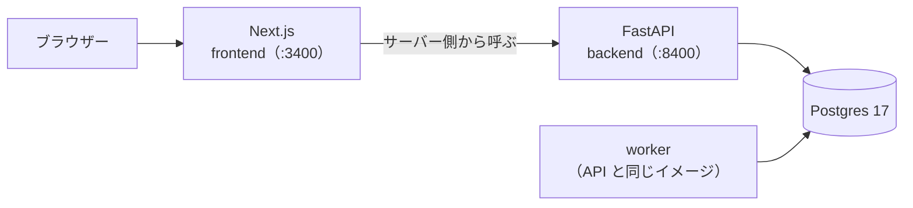

# ShopOrder

[](https://github.com/Starlight-Tree/ShopOrder/actions/workflows/ci.yml)

[English](README.md) | 日本語

架空の惑星ザーハードのアルカ市に 12 店舗を持つカフェチェーン「オアシス珈琲」の、注文と宅配のアプリです（FastAPI、Next.js、Postgres 17、Docker Compose）。お客様は画面で注文し、店は調理ボードと在庫を使い、店長は分析を見ます。店・人・通貨「ルミ」・データはすべて架空で、支払いは模擬です。店頭受け取りと宅配は画面があります。チャットでの注文は、今のところバックエンドだけです。

| お客様（店頭受け取り） | 店のスタッフ |
|---|---|
| **メニュー**<br><a href="docs/screenshots/01-menu.jpg"><picture><source media="(prefers-color-scheme: dark)" srcset="docs/screenshots/01-menu-dark.jpg"></picture></a> | **調理ボード**<br><a href="docs/screenshots/04-staff-board.jpg"><picture><source media="(prefers-color-scheme: dark)" srcset="docs/screenshots/04-staff-board-dark.jpg"></picture></a> |
| **カート**<br><a href="docs/screenshots/02-cart.jpg"><picture><source media="(prefers-color-scheme: dark)" srcset="docs/screenshots/02-cart-dark.jpg"></picture></a> | **在庫**<br><a href="docs/screenshots/05-staff-stock.jpg"><picture><source media="(prefers-color-scheme: dark)" srcset="docs/screenshots/05-staff-stock-dark.jpg"></picture></a> |
| **注文の状況**<br><a href="docs/screenshots/03-order-status.jpg"><picture><source media="(prefers-color-scheme: dark)" srcset="docs/screenshots/03-order-status-dark.jpg"></picture></a> | |

店長は、別の画面を別のログインで使います。数字は、生成した 90 日分の履歴から出しています。

| 店長の分析 | |
|---|---|
| **概況**<br><a href="docs/screenshots/06-manager-overview.jpg"><picture><source media="(prefers-color-scheme: dark)" srcset="docs/screenshots/06-manager-overview-dark.jpg"></picture></a> | **時間帯**<br><a href="docs/screenshots/07-manager-hours.jpg"><picture><source media="(prefers-color-scheme: dark)" srcset="docs/screenshots/07-manager-hours-dark.jpg"></picture></a> |
| **顧客**<br><a href="docs/screenshots/08-manager-customers.jpg"><picture><source media="(prefers-color-scheme: dark)" srcset="docs/screenshots/08-manager-customers-dark.jpg"></picture></a> | |

## 特徴

- **店頭受け取りの注文:** 店を選び、カートに入れ、確認して、模擬決済で支払い、進み具合を見ます。
- **店の画面:** ログインした店の、調理ボードと在庫。
- **二重に売らない在庫:** 在庫は追記だけの台帳です。確定で確保し、15 分で支払われなければ戻します（[ADR 0004](docs/decisions/0004-inventory-ledger-and-reservation.md)）。
- **店長の分析:** 売上・商品・時間帯・在庫・顧客（RFM・コホート）（[docs/metrics.md](docs/metrics.md)）。
- **宅配:** 区画・時間枠・配達員・配車、受け取りの暗証コード。顧客・配車・配達員の画面があります。
- **チャットでの注文**（バックエンドだけ。模擬のモデル）: AI はカートの下書きまで。確定も決済もしません（[ADR 0003](docs/decisions/0003-chat-never-confirms-orders.md)）。
- **権限:** API が毎回、店とロールを確かめます。他店のデータは 404 です。
- **既定は模擬:** 決済・配達・チャットのモデルは差し替えられます。本物は、明示的な承認を得てからです（[ADR 0005](docs/decisions/0005-mock-first-providers.md)）。
- **番号付き SQL のマイグレーション:** 適用済みのファイルの書き換えを検出し、`DROP` は足せません。

## アーキテクチャ



ブラウザーは API を直接呼ばず、画面のサーバー側が呼びます（[docs/api.md](docs/api.md)）。店のスタッフと店長は、別々にログインします。worker は 30 秒ごとに、支払い期限を過ぎた注文を取り消し、在庫を戻します。詳しくは [docs/architecture.md](docs/architecture.md)。

## Quick start

初めての環境（空の DB）では、`migrate` と `seed` を 1 回ずつ実行します（`up` では起動しません）。

```bash
docker compose up -d db
docker compose run --rm migrate         # 番号付き SQL のマイグレーション
docker compose run --rm --build seed    # ダミーの店・メニュー・在庫・デモのスタッフ
docker compose up -d --build
```

- 画面: <http://localhost:3400>、API の文書: <http://localhost:8400/docs>（JobNavi・DocuNavi と同時に動かせるポート）
- 止める: `docker compose down`。DB ごと消すなら `-v` を付けます。
- デモのアカウント（ローカル専用。すべてダミー）: 店のスタッフ `staff-residential-main@oasis-cafe.example` は <http://localhost:3400/staff/login>、店長 `manager@oasis-cafe.example` は <http://localhost:3400/manager/login>。既定のパスワードは `oasis-demo-pass`。お客様は、開発ではログイン不要です。
- 店長の画面に過去の売上を出すには、ダミーの履歴を入れます。デモのデータは入れ直しになります（[docs/development.md](docs/development.md)）。

## テスト

バックエンドには、使い捨ての Postgres 17 が要ります。`TEST_DATABASE_URL` の指すサーバーで、テスト用の DB を作り直す（`DROP DATABASE IF EXISTS` → `CREATE`）ためです。無いと、DB を使うテストは飛ばされます。開発コンテナ（`.devcontainer/`）なら用意済みです（[docs/development.md](docs/development.md)）。

```bash
(cd backend && python3.13 -m venv .venv && .venv/bin/pip install -r requirements.txt -r requirements-dev.in \
  && TEST_DATABASE_URL=postgresql://postgres@127.0.0.1:55432/postgres .venv/bin/python -m pytest -q -rs)
(cd frontend && npm ci && npm test && npm run build && npm run typecheck)
```

## ドキュメント

文書は日本語です。

| 文書 | 内容 |
|---|---|
| [docs/development.md](docs/development.md) | 開発コンテナ、テスト、マイグレーション、ダミーデータ |
| [docs/world.md](docs/world.md) | 架空の世界。店・メニュー・価格（正本） |
| [docs/requirements.md](docs/requirements.md) | 誰が何をするか、範囲、未決 |
| [docs/architecture.md](docs/architecture.md) | 構成、認証、スタック、個人情報 |
| [docs/data-model.md](docs/data-model.md) | テーブルと制約 |
| [docs/order-flow.md](docs/order-flow.md) | 注文の状態、在庫の確保、宅配の決まり |
| [docs/chat.md](docs/chat.md) | チャットでの注文。ツール、安全、評価 |
| [docs/analytics.md](docs/analytics.md) | 分析の画面、顧客データの作法 |
| [docs/metrics.md](docs/metrics.md) | 指標の定義 |
| [docs/api.md](docs/api.md) | 画面とバックエンドの間の API の約束 |
| [docs/roadmap.md](docs/roadmap.md) | 段階（P0〜P6）と状態 |
| [docs/decisions/](docs/decisions/README.md) | 重要な決定（ADR） |
| [evals/README.md](evals/README.md) | チャットの評価。実 API なしで流します |
| [CLAUDE.md](CLAUDE.md) | 開発の規約（AI エージェント向け） |

## このリポジトリについて

個人開発で、同じ在庫を二重に売らない注文、注文を提案はしても確定はしない AI の店員、ダミーデータの分析、を試すために作りました。秘密情報は含みません（`.env` は Git の管理外です）。

## ライセンス

[MIT](LICENSE)
