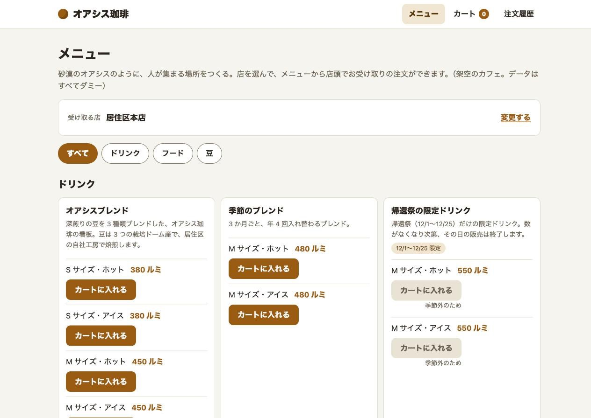
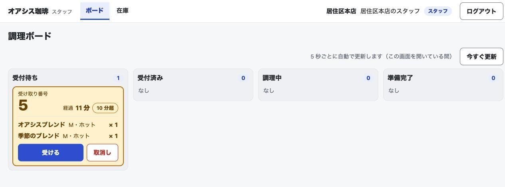
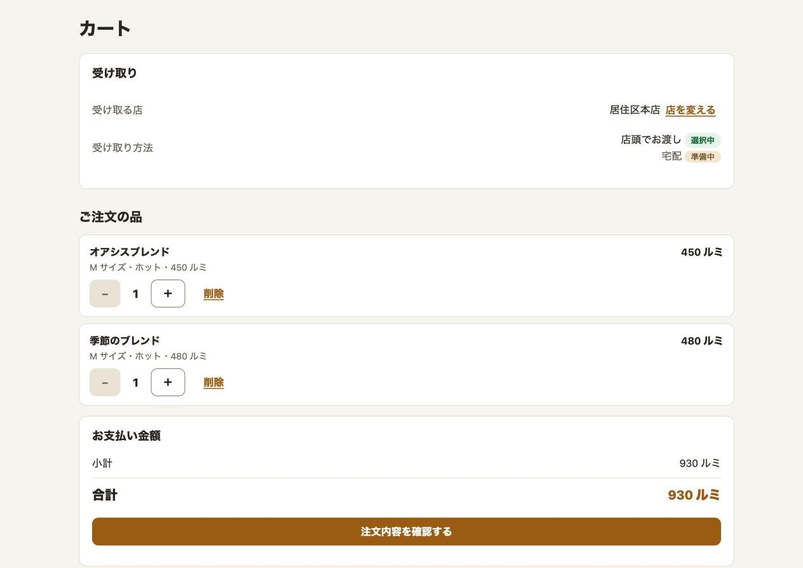
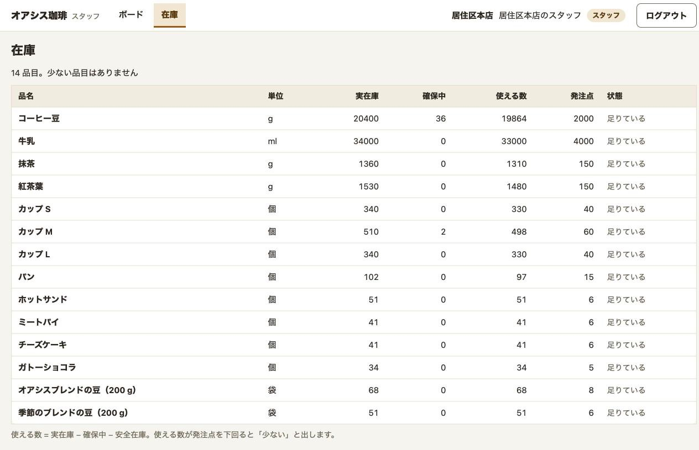
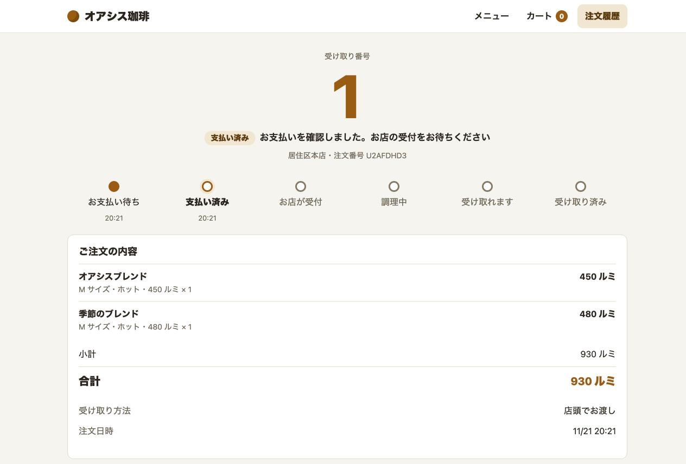
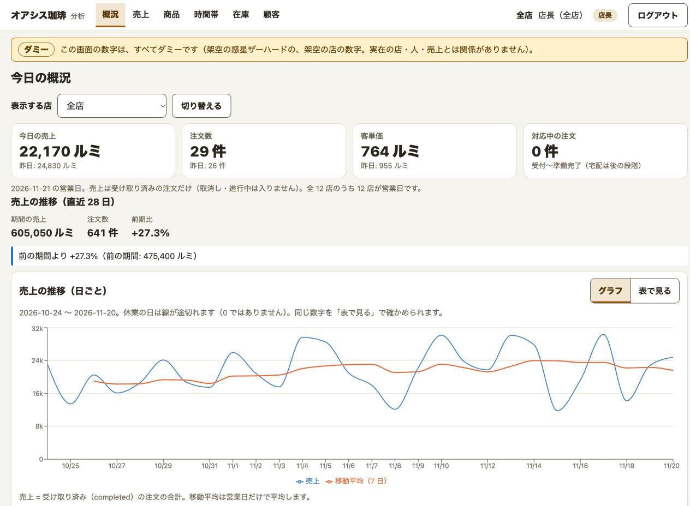
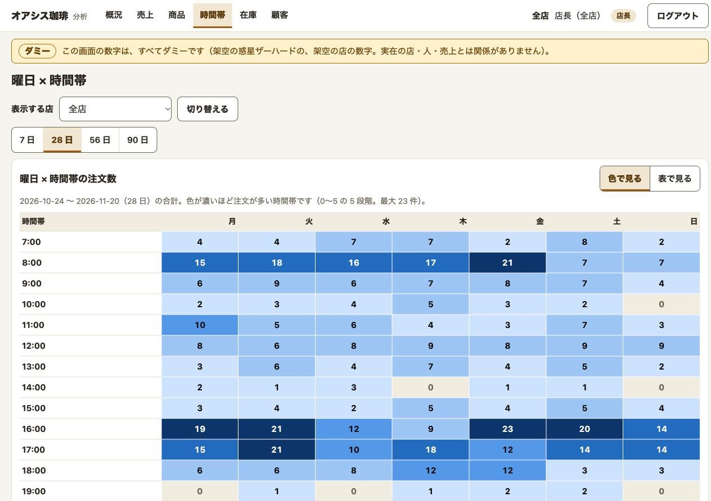
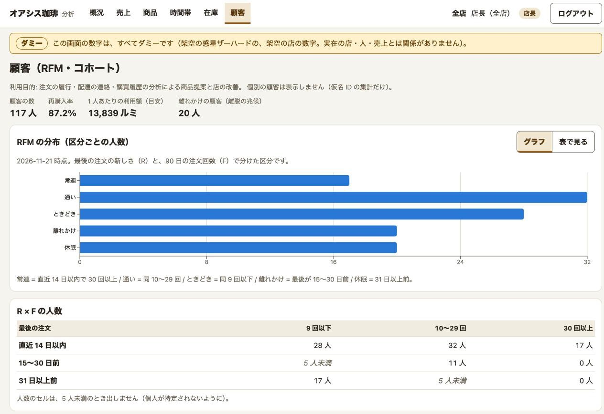
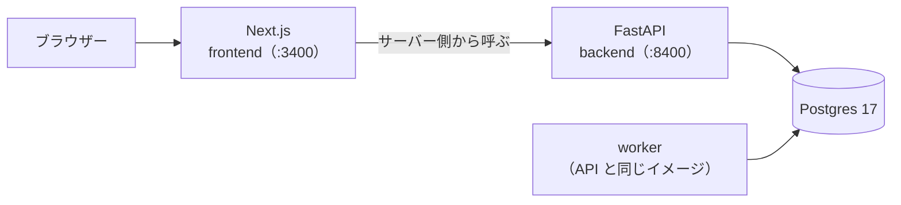

# ShopOrder

[](https://github.com/Starlight-Tree/ShopOrder/actions/workflows/ci.yml)

[English](README.md) | 日本語

「ShopOrder」は、架空の惑星ザーハードのアルカ市に 12 店舗を持つカフェチェーン「オアシス珈琲」の、注文と宅配のアプリです（FastAPI、Next.js、Postgres 17、Docker Compose）。お客様は画面で注文し、店は調理ボードと在庫を使い、店長は分析を見ます。店・人・通貨「ルミ」・データはすべて架空で、支払いは模擬です。店頭受け取りの注文は画面で使えます。宅配とチャットでの注文は、今のところバックエンドだけです。

| お客様（店頭受け取り） | 店のスタッフ |
|---|---|
| **メニュー**<br><a href="docs/screenshots/01-menu.jpg"><picture><source media="(prefers-color-scheme: dark)" srcset="docs/screenshots/01-menu-dark.jpg"></picture></a> | **調理ボード**<br><a href="docs/screenshots/04-staff-board.jpg"><picture><source media="(prefers-color-scheme: dark)" srcset="docs/screenshots/04-staff-board-dark.jpg"></picture></a> |
| **カート**<br><a href="docs/screenshots/02-cart.jpg"><picture><source media="(prefers-color-scheme: dark)" srcset="docs/screenshots/02-cart-dark.jpg"></picture></a> | **在庫**<br><a href="docs/screenshots/05-staff-stock.jpg"><picture><source media="(prefers-color-scheme: dark)" srcset="docs/screenshots/05-staff-stock-dark.jpg"></picture></a> |
| **注文の状況**<br><a href="docs/screenshots/03-order-status.jpg"><picture><source media="(prefers-color-scheme: dark)" srcset="docs/screenshots/03-order-status-dark.jpg"></picture></a> | |

店長は、別の画面（概況・売上・商品・時間帯・在庫・顧客）を、別のログインで使います。下の画面は、生成した 90 日分の履歴から出していて、数字はすべて架空です。

| 店長の分析 | |
|---|---|
| **概況**<br><a href="docs/screenshots/06-manager-overview.jpg"><picture><source media="(prefers-color-scheme: dark)" srcset="docs/screenshots/06-manager-overview-dark.jpg"></picture></a> | **時間帯**<br><a href="docs/screenshots/07-manager-hours.jpg"><picture><source media="(prefers-color-scheme: dark)" srcset="docs/screenshots/07-manager-hours-dark.jpg"></picture></a> |
| **顧客**<br><a href="docs/screenshots/08-manager-customers.jpg"><picture><source media="(prefers-color-scheme: dark)" srcset="docs/screenshots/08-manager-customers-dark.jpg"></picture></a> | |

## 特徴

- **画面で注文できる（店頭受け取り）。** 店を選び、メニュー（季節の品は期間外だと注文できません）からカートに入れ、確認して確定し、模擬決済で支払います。注文の画面は、受け取り番号と進み具合を出し、5 秒ごとに更新します。
- **店の画面。** 調理ボード（受付 → 調理開始 → 準備完了 → 受け渡し。取消しもできます）と在庫（入荷・廃棄・棚卸し）を、ログインした店について出します。店長のアカウントは、店を切り替えられます。
- **二重に売らない在庫。** 在庫は、追記だけの台帳と残高です。注文の確定のときに、条件つきの `UPDATE` で確保し、15 分で支払われなければ戻します（[ADR 0004](docs/decisions/0004-inventory-ledger-and-reservation.md)）。冪等キーで、二重の注文を防ぎます（[docs/order-flow.md](docs/order-flow.md)）。
- **店長の分析。** 概況・売上・商品・時間帯・在庫・顧客（RFM・コホート）を出します。指標の定義は 1 か所に書いています（[docs/metrics.md](docs/metrics.md)）。API とユニットテストがあり、6 つの画面は 2026-11-21 にデスクトップ幅のブラウザーで目視しました（初回の目視で、グラフが描画されない不具合を見つけて直しました）。狭い画面や一部の表示は、まだ確かめていません（[docs/analytics.md](docs/analytics.md)）。宅配の内訳の画面は、まだありません。
- **宅配（バックエンドだけ）。** 区画・送料・時間枠・配達員・配車・不在のお客様の扱いがあり、受け取りのときに暗証コードを確かめます。配達の進行は模擬です。API とテストはありますが、画面はまだありません（[docs/order-flow.md](docs/order-flow.md)）。
- **チャットでの注文（バックエンドだけ。模擬のモデル）。** AI の店員は、カートの下書きと確認カードまでを作れます。注文の確定・決済・個人情報の変更のツールは、AI に渡しません。確定は、画面のボタンだけです（[ADR 0003](docs/decisions/0003-chat-never-confirms-orders.md)）。`evals/` がこれを確かめます。チャットの画面は、まだありません（[docs/chat.md](docs/chat.md)）。
- **ログインと権限。** 店のスタッフと店長は、HttpOnly の Cookie に入れた、意味を持たない（推測できない）セッションのトークンでログインします。API は、店とロールをそこから取り、毎回 SQL の条件で確かめるので、他店のデータは 404 です。お客様の本物のログイン（Google）は、設計だけで、まだ作っていません（P6。[docs/api.md](docs/api.md)）。開発では、お客様はヘッダーで選ぶダミーの利用者です（`AUTH_MODE=dev`）。
- **差し替えられる部品（既定は模擬）。** 決済・配達・チャットのモデルは、インターフェースの裏にあり、既定は模擬です。本物の決済と本物のチャットのモデルは、まだ作っていません（P6）。作るのは、持ち主の明示的な承認を得てからです（[ADR 0005](docs/decisions/0005-mock-first-providers.md)）。
- **番号付き SQL のマイグレーション。** 適用済みのファイルは sha256 で改ざんを検出し、`DROP` は足せず、実行は advisory lock で 1 つずつです。

## アーキテクチャ



ブラウザーは API を直接呼ばず、画面のサーバー側（Server Component、サーバーアクション）が呼びます（[docs/api.md](docs/api.md)）。店のスタッフと店長には、意味を持たない（推測できない）トークン（保存するのはハッシュだけ）を HttpOnly の Cookie で持たせ、店長の画面は別の Cookie なので、別々にログインします。開発では、お客様は `X-Dev-User` ヘッダーで選ぶダミーの利用者で、これに替わる Google のログインは、予定です。worker は 30 秒ごとに、支払い期限を過ぎた注文を取り消し、確保した在庫を戻します。API も、読み取りと確定の前に同じ処理を呼ぶので、worker が止まっても在庫が戻らなくなることはありません。設計とその理由は [docs/architecture.md](docs/architecture.md) です。

## Quick start

Docker Compose で、DB・API・画面・worker を動かします。初めての環境（空の DB）では、`migrate` と `seed` を 1 回ずつ実行します（`up` では起動しない道具です）。`seed` はダミーデータの投入で、`DEMO_DATA=allow` が無いと実行を拒否します（Compose の定義が渡します）。

```bash
docker compose up -d db
docker compose run --rm migrate         # 番号付き SQL のマイグレーション
docker compose run --rm --build seed    # ダミーの店・メニュー・在庫・デモのスタッフ（--build: 古いイメージで流さないため）
docker compose up -d --build
```

- 画面: <http://localhost:3400>、API の文書: <http://localhost:8400/docs>
- ポートは、JobNavi（3200 / 8200）・DocuNavi（3000）と同時に動かせるよう、3400 / 8400 にしてあります。
- 止める: `docker compose down`。DB ごと消すなら `docker compose down -v`
- デモのアカウント（ローカル専用。すべてダミー）: 店のスタッフ `staff-<店の code>@oasis-cafe.example`（例 `staff-residential-main@oasis-cafe.example`）は <http://localhost:3400/staff/login>、店長 `manager@oasis-cafe.example` は <http://localhost:3400/manager/login> から入ります。既定のパスワードは `oasis-demo-pass` です。お客様は、開発ではログイン不要です。
- 店長の画面に過去の売上を出すには、ダミーの履歴を入れます。デモのデータは、入れ直しになります（[docs/development.md](docs/development.md)）。

テスト: バックエンドには、使い捨ての Postgres 17 が要ります。`TEST_DATABASE_URL` の指すサーバーでは、テスト用の DB を作り直す（`DROP DATABASE IF EXISTS` → `CREATE`）ためです。無いと、DB を使うテストは飛ばされます。起動の仕方、`scripts/verify.sh`、マイグレーションとバックアップは [docs/development.md](docs/development.md) です。

```bash
(cd backend && python3.13 -m venv .venv && .venv/bin/pip install -r requirements.txt -r requirements-dev.in \
  && TEST_DATABASE_URL=postgresql://postgres@127.0.0.1:55432/postgres .venv/bin/python -m pytest -q -rs)
(cd frontend && npm ci && npm test && npm run build && npm run typecheck)
```

## ドキュメント

文書は日本語です。

| 文書 | 内容 |
|---|---|
| [docs/development.md](docs/development.md) | テスト、マイグレーションとバックアップ、ダミーデータ、名前の決まり |
| [docs/world.md](docs/world.md) | 架空の世界。店・メニュー・価格（ルミ）・宅配の設定（正本） |
| [docs/requirements.md](docs/requirements.md) | 誰が何をするか、範囲（MVP / 後 / やらない）、未決 |
| [docs/architecture.md](docs/architecture.md) | 構成、認証、差し替え口、スタック、個人情報 |
| [docs/data-model.md](docs/data-model.md) | テーブルと制約 |
| [docs/order-flow.md](docs/order-flow.md) | 注文の状態、確定、在庫の確保、宅配の決まり |
| [docs/chat.md](docs/chat.md) | チャットでの注文。ツール、安全、評価 |
| [docs/analytics.md](docs/analytics.md) | 分析の作り方、画面、顧客データの作法 |
| [docs/metrics.md](docs/metrics.md) | 指標の定義 |
| [docs/api.md](docs/api.md) | 画面とバックエンドの間の API の約束 |
| [docs/roadmap.md](docs/roadmap.md) | 段階（P0〜P6）と状態 |
| [docs/decisions/](docs/decisions/README.md) | 重要な決定（ADR）とその理由 |
| [evals/README.md](evals/README.md) | チャットの評価。正解例と安全の事例を、実 API なしで流す |
| [CLAUDE.md](CLAUDE.md) | 開発の規約（AI エージェント向け。docs/ にもあります） |

## このリポジトリについて

個人開発で、同じ在庫を二重に売らない注文、注文を提案はしても確定はしない AI の店員、ダミーデータの分析、といった課題を試すために作りました。秘密情報は含みません（`.env` は Git の管理外で、既定の設定は秘密なしで動きます）。パターンによる秘密の検査は、完全な保証ではありません。

## ライセンス

[MIT](LICENSE)
