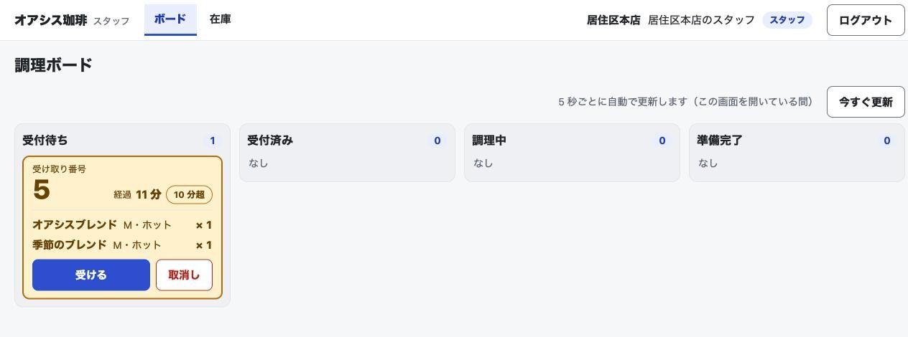
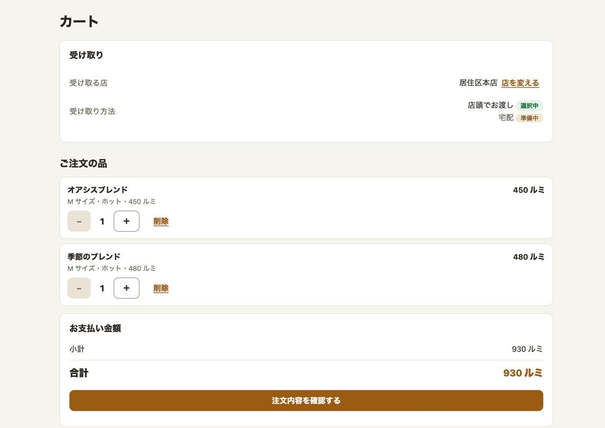
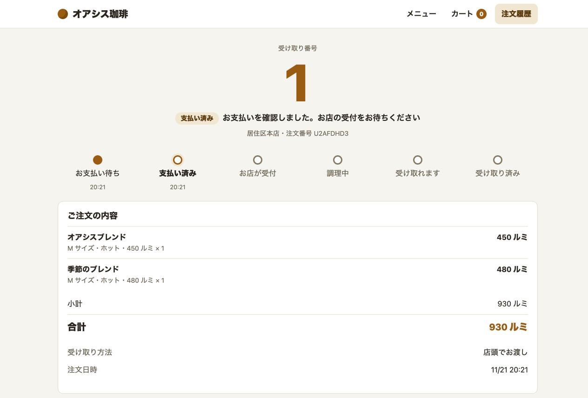
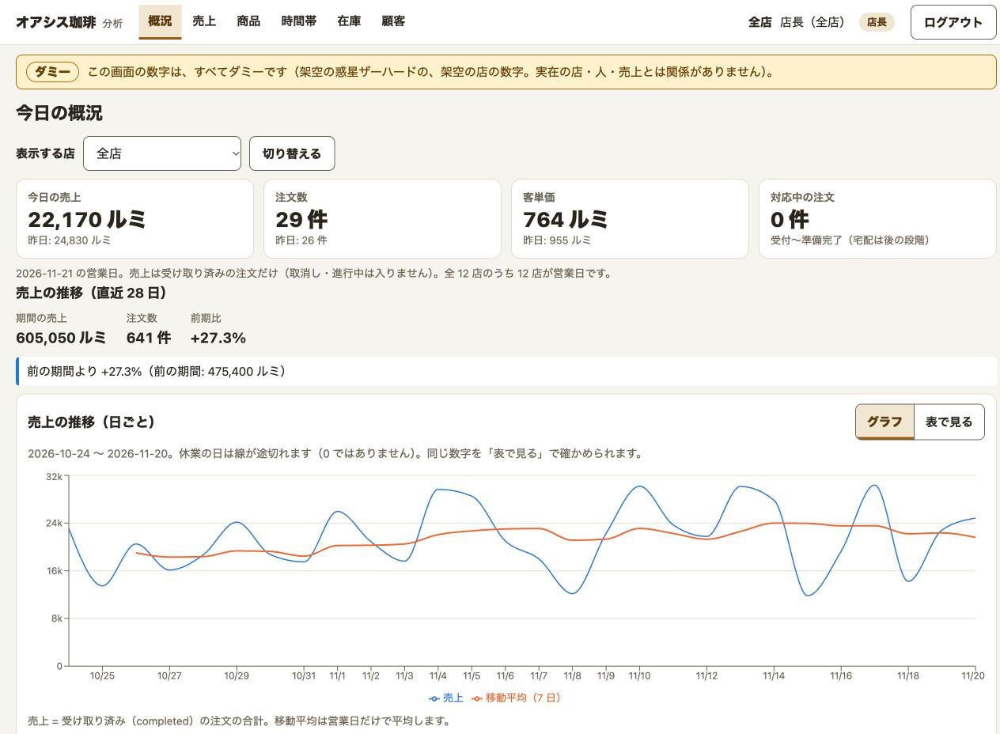
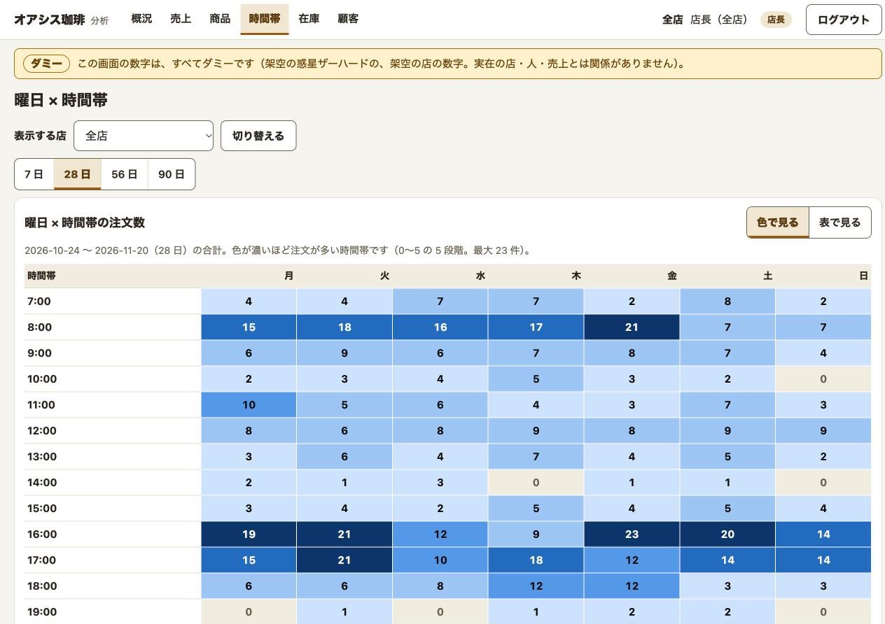
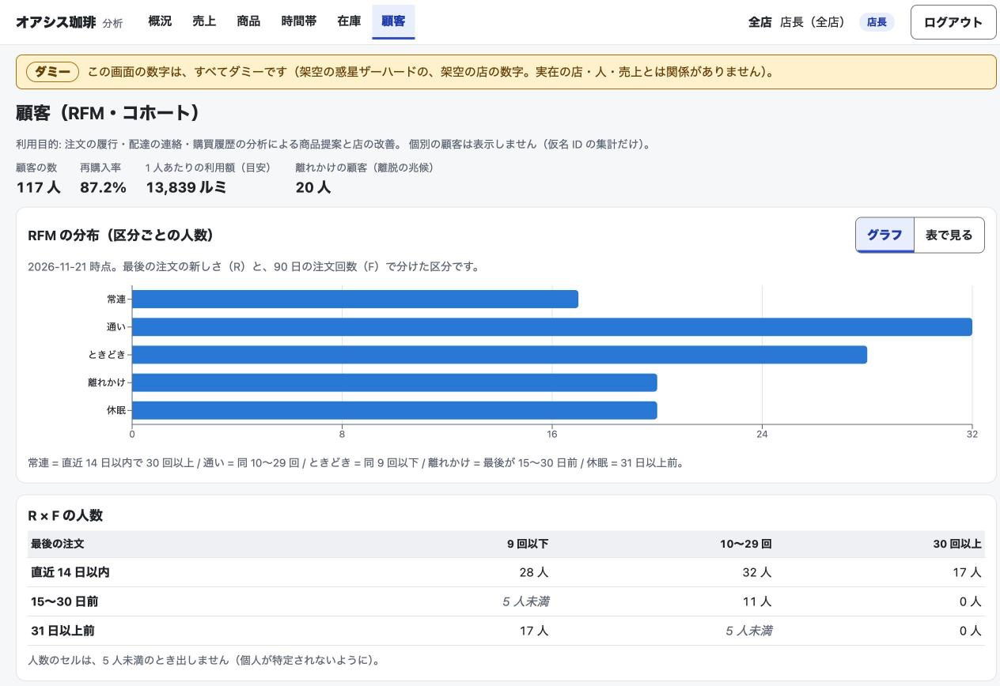
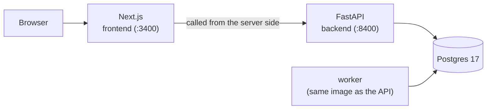

# ShopOrder

[](https://github.com/Starlight-Tree/ShopOrder/actions/workflows/ci.yml)

English | [日本語](README.ja.md)

A fictional ordering and delivery app for "Oasis Coffee" (オアシス珈琲), a 12-store café chain on the planet Zahard (FastAPI, Next.js, Postgres 17, Docker Compose). Customers order on screen, stores run a prep board and stock, managers read analytics. Stores, people, the currency "lumi" and all data are made up, and payment is a mock. Store pickup and delivery have screens; chat ordering is backend-only so far.

| Customer (store pickup) | Store staff |
|---|---|
| **Menu**<br><a href="docs/screenshots/01-menu.jpg"><picture><source media="(prefers-color-scheme: dark)" srcset="docs/screenshots/01-menu-dark.jpg"></picture></a> | **Prep board**<br><a href="docs/screenshots/04-staff-board.jpg"><picture><source media="(prefers-color-scheme: dark)" srcset="docs/screenshots/04-staff-board-dark.jpg"></picture></a> |
| **Cart**<br><a href="docs/screenshots/02-cart.jpg"><picture><source media="(prefers-color-scheme: dark)" srcset="docs/screenshots/02-cart-dark.jpg"></picture></a> | **Stock**<br><a href="docs/screenshots/05-staff-stock.jpg"><picture><source media="(prefers-color-scheme: dark)" srcset="docs/screenshots/05-staff-stock-dark.jpg"></picture></a> |
| **Order status**<br><a href="docs/screenshots/03-order-status.jpg"><picture><source media="(prefers-color-scheme: dark)" srcset="docs/screenshots/03-order-status-dark.jpg"></picture></a> | |

Managers use a separate console with its own login. Its numbers come from 90 days of generated history.

| Manager analytics | |
|---|---|
| **Overview**<br><a href="docs/screenshots/06-manager-overview.jpg"><picture><source media="(prefers-color-scheme: dark)" srcset="docs/screenshots/06-manager-overview-dark.jpg"></picture></a> | **Time of day**<br><a href="docs/screenshots/07-manager-hours.jpg"><picture><source media="(prefers-color-scheme: dark)" srcset="docs/screenshots/07-manager-hours-dark.jpg"></picture></a> |
| **Customers**<br><a href="docs/screenshots/08-manager-customers.jpg"><picture><source media="(prefers-color-scheme: dark)" srcset="docs/screenshots/08-manager-customers-dark.jpg"></picture></a> | |

## Features

- **Store-pickup ordering:** choose a store, fill the cart, confirm, pay (mock), follow the order.
- **Store screens:** a prep board and stock for the signed-in store.
- **No double selling:** stock is an append-only ledger; confirming an order reserves it, and unpaid reservations are released after 15 minutes ([ADR 0004](docs/decisions/0004-inventory-ledger-and-reservation.md)).
- **Manager analytics:** sales, products, time of day, stock, customers (RFM, cohorts) ([docs/metrics.md](docs/metrics.md)).
- **Delivery:** zones, time slots, couriers, dispatch, a PIN at hand-over, with customer, dispatch and courier screens.
- **Chat ordering** (backend only, mock model): the assistant can draft a cart but never confirms or pays ([ADR 0003](docs/decisions/0003-chat-never-confirms-orders.md)).
- **Permissions:** the API checks store and role on every request; another store's data is a 404.
- **Mock first:** payment, delivery and the chat model are swappable, and real ones need explicit approval ([ADR 0005](docs/decisions/0005-mock-first-providers.md)).
- **Numbered SQL migrations:** edits to applied files are detected, and `DROP` is not allowed.

## Architecture



The browser never calls the API directly; the server side of the UI does ([docs/api.md](docs/api.md)). Staff and managers sign in separately. The worker cancels unpaid orders every 30 seconds and releases their stock. Details: [docs/architecture.md](docs/architecture.md).

## Quick start

On a new environment (empty DB), run `migrate` and `seed` once; `up` does not start them.

```bash
docker compose up -d db
docker compose run --rm migrate         # numbered SQL migrations
docker compose run --rm --build seed    # dummy stores, menu, stock and demo staff
docker compose up -d --build
```

- UI: <http://localhost:3400>, API docs: <http://localhost:8400/docs> (the ports leave room for JobNavi and DocuNavi).
- Stop: `docker compose down`; add `-v` to delete the DB too.
- Demo accounts (local only, all dummy): staff `staff-residential-main@oasis-cafe.example` at <http://localhost:3400/staff/login>, manager `manager@oasis-cafe.example` at <http://localhost:3400/manager/login>. The default password is `oasis-demo-pass`. Customers need no login in development.
- For past sales in the manager console, load the demo history ([docs/development.md](docs/development.md)); it resets the demo data.

## Tests

The backend tests need a throwaway Postgres 17: `TEST_DATABASE_URL` points at a server where the test database is dropped and recreated. Without it, the DB tests are skipped. A dev container (`.devcontainer/`) sets this up; see [docs/development.md](docs/development.md).

```bash
(cd backend && python3.13 -m venv .venv && .venv/bin/pip install -r requirements.txt -r requirements-dev.in \
  && TEST_DATABASE_URL=postgresql://postgres@127.0.0.1:55432/postgres .venv/bin/python -m pytest -q -rs)
(cd frontend && npm ci && npm test && npm run build && npm run typecheck)
```

## Documentation

The documents are written in Japanese.

| Document | Contents |
|---|---|
| [docs/development.md](docs/development.md) | Dev container, tests, migrations, demo data |
| [docs/world.md](docs/world.md) | The fictional world: stores, menu, prices (source of truth) |
| [docs/requirements.md](docs/requirements.md) | Roles, scope, open questions |
| [docs/architecture.md](docs/architecture.md) | Structure, authentication, stack, personal data |
| [docs/data-model.md](docs/data-model.md) | Tables and constraints |
| [docs/order-flow.md](docs/order-flow.md) | Order states, stock reservation, delivery rules |
| [docs/chat.md](docs/chat.md) | Chat ordering: tools, safety, evaluation |
| [docs/analytics.md](docs/analytics.md) | Analytics screens and handling of customer data |
| [docs/metrics.md](docs/metrics.md) | Metric definitions |
| [docs/api.md](docs/api.md) | The API contract between the UI and the backend |
| [docs/roadmap.md](docs/roadmap.md) | Phases P0 to P6 and their status |
| [docs/decisions/](docs/decisions/README.md) | Architecture decision records (ADRs) |
| [evals/README.md](evals/README.md) | Chat evaluation, run without a real API |
| [CLAUDE.md](CLAUDE.md) | Development conventions (for AI agents) |

## About

A personal project exploring ordering that cannot sell the same stock twice, an AI assistant that can propose but never confirm an order, and analytics over dummy data. It contains no secrets (`.env` is outside Git).

## License

[MIT](LICENSE)
