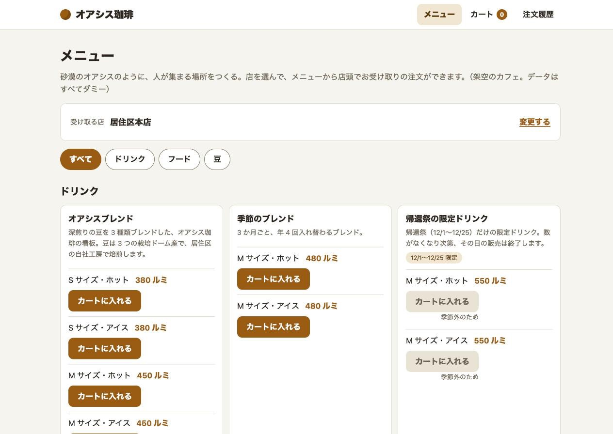
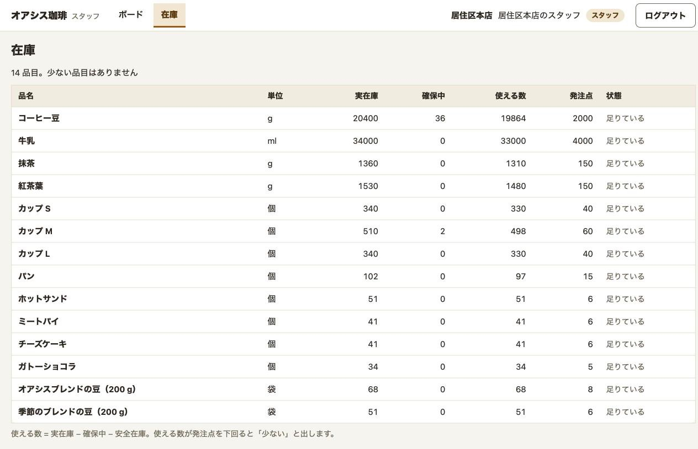
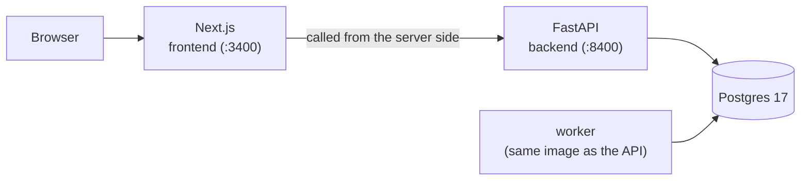

# ShopOrder

[](https://github.com/Starlight-Tree/ShopOrder/actions/workflows/ci.yml)

English | [日本語](README.ja.md)

ShopOrder is a fictional ordering and delivery app for "Oasis Coffee" (オアシス珈琲), a 12-store café chain in the city of Arca on the planet Zahard (FastAPI, Next.js, Postgres 17, Docker Compose). Customers order on screen, stores run a prep board and their stock, and managers read the analytics. The stores, people, currency "lumi" and all data are made up, and payment is a mock. Pickup ordering works on screen; delivery and chat ordering are backend-only so far.

| Customer (store pickup) | Store staff |
|---|---|
| **Menu**<br><a href="docs/screenshots/01-menu.jpg"><picture><source media="(prefers-color-scheme: dark)" srcset="docs/screenshots/01-menu-dark.jpg"></picture></a> | **Prep board**<br><a href="docs/screenshots/04-staff-board.jpg"><picture><source media="(prefers-color-scheme: dark)" srcset="docs/screenshots/04-staff-board-dark.jpg"></picture></a> |
| **Cart**<br><a href="docs/screenshots/02-cart.jpg"><picture><source media="(prefers-color-scheme: dark)" srcset="docs/screenshots/02-cart-dark.jpg"></picture></a> | **Stock**<br><a href="docs/screenshots/05-staff-stock.jpg"><picture><source media="(prefers-color-scheme: dark)" srcset="docs/screenshots/05-staff-stock-dark.jpg"></picture></a> |
| **Order status**<br><a href="docs/screenshots/03-order-status.jpg"><picture><source media="(prefers-color-scheme: dark)" srcset="docs/screenshots/03-order-status-dark.jpg"></picture></a> | |

Managers use a separate console (overview, sales, products, time of day, stock, customers) with its own login.

## Features

- **Ordering on screen (store pickup).** Choose a store, browse the menu (seasonal items switch off out of season), fill the cart, confirm, and pay with a mock payment. The order page shows the pickup number and progress, and refreshes every 5 seconds.
- **Store screens.** A prep board (accept → start → ready → handed over, or cancel) and stock (receive, discard, stocktake) for the signed-in store. A manager account can switch stores.
- **Stock that cannot be sold twice.** Stock is an append-only ledger plus a balance. Confirming an order reserves stock with a conditional `UPDATE`, and the reservation is released if the order is not paid within 15 minutes ([ADR 0004](docs/decisions/0004-inventory-ledger-and-reservation.md)). An idempotency key prevents duplicate orders ([docs/order-flow.md](docs/order-flow.md)).
- **Manager analytics.** Overview, sales, products, time of day, stock and customers (RFM, cohorts), with each metric defined in one place ([docs/metrics.md](docs/metrics.md)). It is covered by API and unit tests, but not yet reviewed by eye in a browser ([docs/analytics.md](docs/analytics.md)). There is no delivery breakdown screen yet.
- **Delivery (backend only).** Zones, fees, time slots, couriers, dispatch, a PIN checked at hand-over, and handling of customers who are not at home, with mock progress. It has an API and tests, but no screens yet ([docs/order-flow.md](docs/order-flow.md)).
- **Ordering by chat (backend only, mock model).** An AI shop assistant can prepare a cart draft and a confirmation card, but is never given a tool that confirms an order, pays, or changes personal data. Confirming is the button on the screen only ([ADR 0003](docs/decisions/0003-chat-never-confirms-orders.md)). `evals/` checks this, and there is no chat screen yet ([docs/chat.md](docs/chat.md)).
- **Logins and permissions.** Staff and managers sign in with an opaque session token in an HttpOnly cookie. The API takes their store and role from it and checks them in SQL on every request, so another store's data is a 404. A real customer sign-in (Google) is designed but not built (P6, [docs/api.md](docs/api.md)); in development a customer is a dummy user chosen by a header (`AUTH_MODE=dev`).
- **Swappable providers, mock by default.** Payment, delivery and the chat model sit behind interfaces, and the default is a mock. Real payment and a real chat model are not built yet (P6), and will be added only after the owner's explicit approval ([ADR 0005](docs/decisions/0005-mock-first-providers.md)).
- **Numbered SQL migrations.** Applied files are checked by sha256 to detect edits, `DROP` is not allowed, and runs are serialized with an advisory lock.

## Architecture



The browser never calls the API directly; the server side of the UI (Server Components, server actions) does ([docs/api.md](docs/api.md)). Staff and managers get an opaque token (only its hash is stored) in an HttpOnly cookie, and the manager console uses its own cookie, so you sign in to each separately. In development a customer is a dummy user chosen by the `X-Dev-User` header; the Google sign-in that replaces it is planned. The worker runs every 30 seconds, cancels orders that were not paid in time and releases their reserved stock; the API runs the same sweep before reads and confirms, so a stopped worker does not freeze stock. The design and its reasons are in [docs/architecture.md](docs/architecture.md).

## Quick start

Docker Compose runs the DB, the API, the UI and the worker. On a new environment (empty DB), run `migrate` and `seed` once each (they are tools that `up` does not start). `seed` loads dummy data and refuses to run without `DEMO_DATA=allow` (the Compose file passes it).

```bash
docker compose up -d db
docker compose run --rm migrate         # numbered SQL migrations
docker compose run --rm --build seed    # dummy stores, menu, stock and demo staff (--build: so an old image is not used)
docker compose up -d --build
```

- UI: <http://localhost:3400>, API docs: <http://localhost:8400/docs>
- The ports are 3400 and 8400 so that the app can run next to JobNavi (3200 / 8200) and DocuNavi (3000).
- Stop: `docker compose down`. To delete the DB as well: `docker compose down -v`
- Demo accounts (local only, all dummy): store staff `staff-<store code>@oasis-cafe.example` (for example `staff-residential-main@oasis-cafe.example`) at <http://localhost:3400/staff/login>, and the manager `manager@oasis-cafe.example` at <http://localhost:3400/manager/login>. The default password is `oasis-demo-pass`. Customers need no login in development.
- To see past sales in the manager console, load the demo history. This resets the demo data ([docs/development.md](docs/development.md)).

Tests: the backend needs a throwaway Postgres 17, because `TEST_DATABASE_URL` points at a server where the test database is recreated (`DROP DATABASE IF EXISTS`, then `CREATE`). Without it, the tests that need the DB are skipped. How to start one, `scripts/verify.sh`, migrations and backups are in [docs/development.md](docs/development.md).

```bash
(cd backend && python3.13 -m venv .venv && .venv/bin/pip install -r requirements.txt -r requirements-dev.in \
  && TEST_DATABASE_URL=postgresql://postgres@127.0.0.1:55432/postgres .venv/bin/python -m pytest -q -rs)
(cd frontend && npm ci && npm test && npm run build && npm run typecheck)
```

## Documentation

The documents are written in Japanese.

| Document | Contents |
|---|---|
| [docs/development.md](docs/development.md) | Tests, migrations and backups, demo data, naming |
| [docs/world.md](docs/world.md) | The fictional world: stores, menu, prices in lumi, delivery settings (the source of truth) |
| [docs/requirements.md](docs/requirements.md) | Who does what, scope (MVP / later / out), open questions |
| [docs/architecture.md](docs/architecture.md) | Structure, authentication, swap points, stack, personal data |
| [docs/data-model.md](docs/data-model.md) | Tables and constraints |
| [docs/order-flow.md](docs/order-flow.md) | Order states, checkout, stock reservation, delivery rules |
| [docs/chat.md](docs/chat.md) | Chat ordering: tools, safety, evaluation |
| [docs/analytics.md](docs/analytics.md) | How analytics is built, screens, handling of customer data |
| [docs/metrics.md](docs/metrics.md) | Definitions of the metrics |
| [docs/api.md](docs/api.md) | The API contract between the UI and the backend |
| [docs/roadmap.md](docs/roadmap.md) | Phases P0 to P6 and their status |
| [docs/decisions/](docs/decisions/README.md) | Important decisions (architecture decision records, ADRs) and their reasons |
| [evals/README.md](evals/README.md) | Chat evaluation: golden and safety cases, run without a real API |
| [CLAUDE.md](CLAUDE.md) | Development conventions (for AI agents; docs/ has one too) |

## About this repository

A personal project built to explore: ordering that cannot sell the same stock twice, an AI assistant that can propose but never confirm an order, and analytics over dummy data. It contains no secrets (`.env` is outside Git, and the defaults need no secrets). Pattern-based secret checks are not a complete guarantee.

## License

[MIT](LICENSE)
